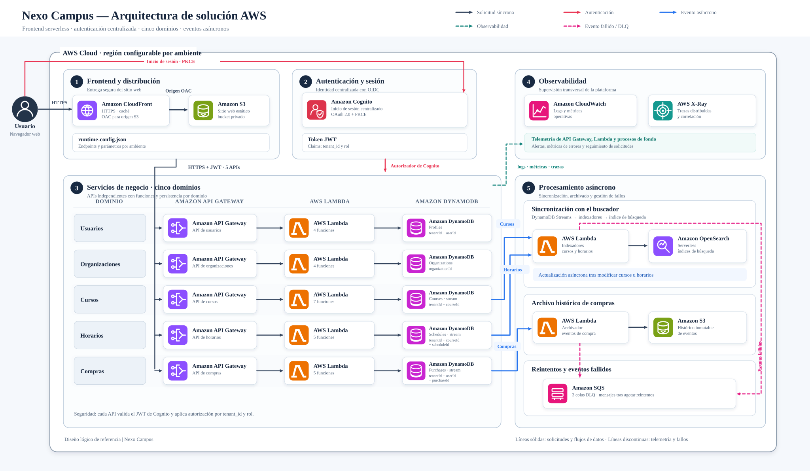

# Nexo Campus

Plataforma académica multi-tenant para administrar organizaciones, usuarios, cursos, horarios y matrículas. La solución utiliza una arquitectura serverless en AWS, separada en cinco dominios con APIs, funciones y datos independientes.



Una versión editable de la arquitectura está disponible en [aws-solution-architecture.drawio](docs/architecture/aws-solution-architecture.drawio).

## Arquitectura de solución

1. **Entrega web:** Amazon CloudFront publica el frontend React almacenado en un bucket Amazon S3 privado. Origin Access Control evita el acceso público directo al bucket.
2. **Identidad:** Amazon Cognito administra usuarios, Hosted UI y OAuth 2.0 Authorization Code con PKCE. Los tokens incluyen `sub`, `custom:tenant_id` y `custom:role`.
3. **APIs:** cinco Amazon API Gateway REST separan Users, Organizations, Courses, Schedules y Purchases. Cada API tiene Cognito Authorizer y throttling propios.
4. **Cómputo:** 25 funciones AWS Lambda implementan operaciones HTTP y workers asíncronos. Los handlers aplican aislamiento por tenant y autorización por rol.
5. **Datos:** cada dominio tiene su propia tabla Amazon DynamoDB con capacidad bajo demanda, cifrado y point-in-time recovery.
6. **Procesamiento asíncrono:** DynamoDB Streams mantiene índices de cursos y horarios en Amazon OpenSearch Serverless y archiva eventos de compras en Amazon S3. Amazon SQS conserva los eventos que agotan los reintentos.
7. **Plataforma:** AWS CDK define la infraestructura, AWS CloudFormation la aprovisiona y Amazon CloudWatch con AWS X-Ray centralizan logs, métricas y trazas.

La organización representa el tenant. Un usuario con rol `admin` administra únicamente los recursos asociados a su `tenant_id`.

### Flujo de matrícula

1. El frontend genera un `Idempotency-Key` y envía únicamente `courseId` y `scheduleId` a Purchases API.
2. Cognito Authorizer valida el JWT; la Lambda obtiene `tenantId` y `userId` de sus claims, nunca del body.
3. La Lambda consulta el curso y el horario en DynamoDB. El precio se toma del catálogo y no del navegador.
4. Una transacción DynamoDB incrementa `occupiedCount` sólo si el horario está abierto y conserva capacidad; en la misma operación crea la compra con estado `reserved`.
5. Reintentar la misma clave devuelve la compra original. Una cancelación cambia el estado y libera el cupo en otra transacción atómica.
6. DynamoDB Streams activa `PurchaseArchiver`, que conserva el evento en S3; sus errores agotados terminan en una DLQ de SQS.

Las Lambdas no se llaman directamente entre sí en este flujo. Comparten contratos y se coordinan mediante DynamoDB, transacciones y Streams, reduciendo el acoplamiento entre dominios.

## Infraestructura como código

La aplicación se divide en diez stacks:

| Stack | Infraestructura |
|---|---|
| `Foundation` | bucket S3 de archivo y configuración regional de logs de API Gateway |
| `Web` | S3 privado, CloudFront, OAC, headers de seguridad y publicación del frontend |
| `Auth` | Cognito User Pool, cliente PKCE, Hosted UI y grupos de aplicación |
| `Search` | OpenSearch Serverless y políticas de cifrado, red y datos |
| `Users` | API, Lambdas y tabla Profiles |
| `Organizations` | API, Lambdas y tabla Organizations |
| `Courses` | API, Lambdas, tabla, Stream, indexador y DLQ |
| `Schedules` | API, Lambdas, tabla, Stream, indexador y DLQ |
| `Purchases` | API, Lambdas, reserva transaccional de cupos, tabla, Stream, archivador S3 y DLQ |
| `Monitoring` | dashboard central de CloudWatch |

`infrastructure/cdk/bin/app.ts` compone los stacks y sus dependencias. Los archivos de `infrastructure/cdk/stacks/` describen los recursos de cada dominio y `infrastructure/cdk/constructs/` contiene componentes reutilizables para APIs, Lambdas, tablas, Streams y colas.

CDK sintetiza plantillas CloudFormation. Durante el deploy, CloudFormation crea o actualiza los recursos y devuelve sus URLs, IDs y nombres mediante outputs. El script genera `runtime-config.json` con esos valores y lo publica en el bucket web; por eso los handlers no contienen IPs, nombres físicos ni endpoints escritos manualmente.

## IAM y seguridad

En una cuenta AWS estándar, CDK crea un **execution role por Lambda**. Cada rol recibe escritura sobre su log group y sólo las acciones requeridas por su función, por ejemplo:

- `dynamodb:GetItem`, `PutItem`, `Query` o `DeleteItem` sobre la tabla correspondiente.
- `aoss:APIAccessAll` junto con una data access policy limitada a la colección e índices usados.
- `s3:PutObject` para el archivador de compras.
- permisos de consumo de DynamoDB Streams y envío a la DLQ para los workers.

También crea un rol regional para que API Gateway publique logs en CloudWatch. Si se configura `LAB_ROLE_ARN`, se reutiliza el rol restringido proporcionado por AWS Academy.

Los grupos Cognito `admin`, `instructor` y `student` representan permisos dentro de la aplicación; no sustituyen los roles IAM utilizados por los servicios AWS.

Los buckets bloquean acceso público, requieren TLS, utilizan cifrado administrado por AWS y conservan versiones. Producción aplica retención de recursos y logs, protección de eliminación de Cognito y réplicas de espera en OpenSearch.

## Estructura del repositorio

```text
apps/web/                         frontend React/Vite y cliente Cognito
services/*-service/src/functions handlers Lambda HTTP por dominio
services/*-service/src/workers   consumidores de DynamoDB Streams
services/*-service/docs/         contratos OpenAPI y ejemplos
packages/                        contratos, validación, logging y clientes AWS
infrastructure/cdk/bin/          composición de stacks
infrastructure/cdk/stacks/       infraestructura por dominio
infrastructure/cdk/constructs/   componentes CDK reutilizables
config/                          configuración dev, staging y production
scripts/deploy/                  despliegue completo y runtime config
scripts/ingestion/               carga opcional de datos demostrativos
tests/                           pruebas de integración y end-to-end
```

## Despliegue en producción

Requisitos:

- Node.js 24.
- AWS CLI autenticado mediante perfil, credenciales STS temporales o rol de CI.
- AWS CDK bootstrap ejecutado en la cuenta y región de destino.
- Permisos para CloudFormation, IAM, Lambda, API Gateway, Cognito, DynamoDB, S3, CloudFront, OpenSearch Serverless, SQS y CloudWatch.

Configuración privada en `.env.local`:

```dotenv
AWS_PROFILE=production
AWS_REGION=us-east-1
STAGE=production
EXPECTED_AWS_ACCOUNT_ID=123456789012
```

Despliegue:

```powershell
npm.cmd ci
npm.cmd run validate
npx.cmd cdk bootstrap aws://123456789012/us-east-1
npm.cmd run deploy:production
```

El proceso compila el frontend, sintetiza y despliega los diez stacks, guarda los outputs generados por AWS, publica `runtime-config.json` y crea una invalidación de CloudFront.

Las credenciales, archivos `.env.local`, outputs de CloudFormation y artefactos de compilación están excluidos de Git.

## Documentación de APIs

Cada dominio mantiene su contrato en:

```text
services/users-service/docs/openapi.yaml
services/organizations-service/docs/openapi.yaml
services/courses-service/docs/openapi.yaml
services/schedules-service/docs/openapi.yaml
services/purchases-service/docs/openapi.yaml
```

## Referencias

- [AWS Architecture Icons](https://aws.amazon.com/architecture/icons/)
- [AWS CDK deployment](https://docs.aws.amazon.com/cdk/v2/guide/deploy.html)
- [API Gateway Cognito Authorizer](https://docs.aws.amazon.com/apigateway/latest/developerguide/apigateway-enable-cognito-user-pool.html)
- [AWS Lambda permissions](https://docs.aws.amazon.com/lambda/latest/dg/lambda-permissions.html)
- [CloudFront Origin Access Control](https://docs.aws.amazon.com/AmazonCloudFront/latest/DeveloperGuide/private-content-restricting-access-to-s3.html)
- [DynamoDB Streams with Lambda](https://docs.aws.amazon.com/lambda/latest/dg/services-dynamodb-eventsourcemapping.html)
